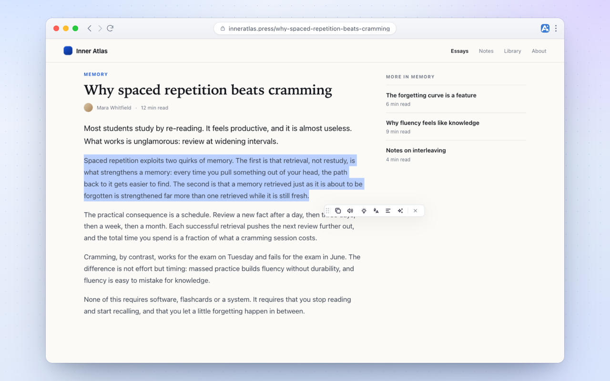
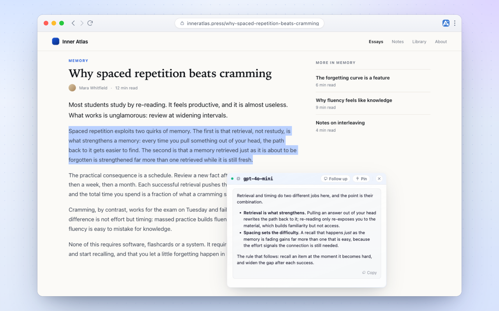
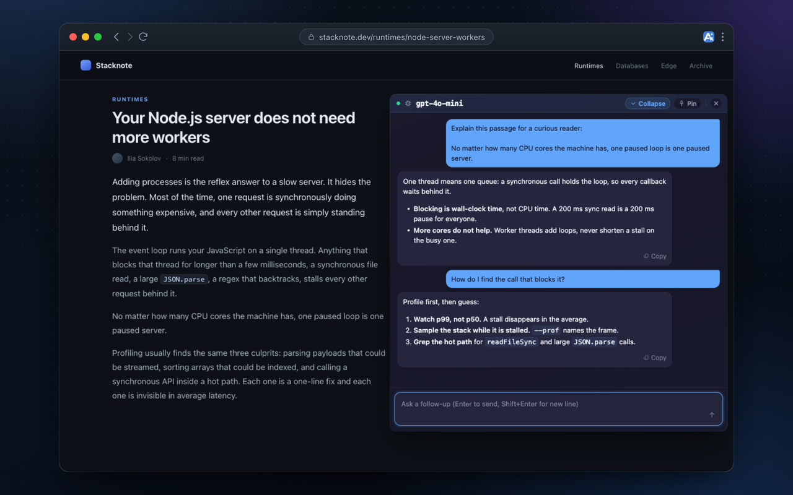
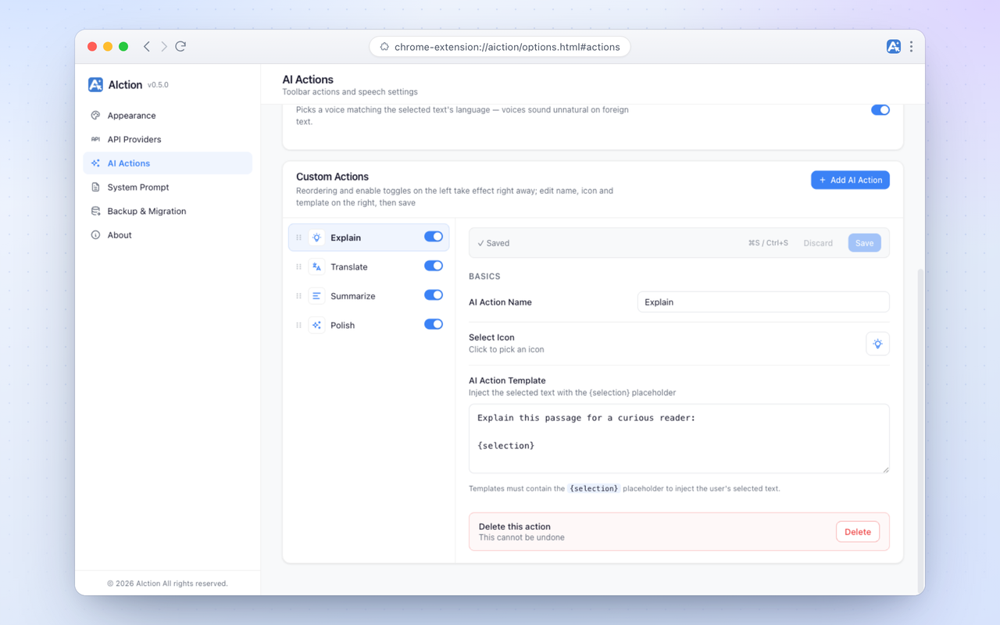

# AIction Browser

> 选中文本 → 触发 AI → 继续对话

轻量级 Chrome 扩展，为网页上选中的内容提供 AI 辅助：划词后工具栏浮现，选一个动作看答案流式出现，然后在浮动面板里继续追问。支持任意遵循 OpenAI chat completions 格式的端点 —— 你的 Key、你的模型、你的账单。

> 🛒 **已上架 Chrome 网上应用店：**
> **[从 Chrome 商店安装 AIction](https://chromewebstore.google.com/detail/aiction-custom-ai-actions/heedegdamjmjffdojaihadbndemmocin?utm_source=github)**

> ⚠️ **注意**：这是浏览器扩展组件。桌面版请访问 [AIction Desktop](https://github.com/lerixhe/aiction)。

[](LICENSE)
[](https://chromewebstore.google.com/detail/aiction-custom-ai-actions/heedegdamjmjffdojaihadbndemmocin)
[](package.json)
[](src/shared/i18n/registry.ts)

**[English](./README.md)**

## 截图

<table>
  <tr>
    <td width="50%"></td>
    <td width="50%"></td>
  </tr>
  <tr>
    <td width="50%"></td>
    <td width="50%"></td>
  </tr>
</table>

## 功能特性

### 内联工具栏

在任意网页选中文本，工具栏随之出现在选区旁，包含你的动作，以及一键**复制**与**朗读**。

### 浮动对话面板

答案先流式落在紧凑的卡片里，想追问时切到聊天态。面板可拖拽、可钉住，同一页面上能同时开多个；会话是每页内存态，关掉或刷新标签页即销毁。

### 动作由你定义

每个工具栏按钮都是提示词模板：用 `{selection}` 代表选中的文字，名称、图标、模板、排序、启停全部可改。内置两个动作：

| 动作 | 行为 |
|------|------|
| 解释 | 先说结论、不复述原文，篇幅随内容复杂度伸缩 |
| 中英互译 | 自动判定方向：主体为英文 → 简体中文，主体为中文 → 英文；只输出译文并保留原有格式 |

### 用你自己的模型

可以添加任意多个服务商 —— OpenAI、Anthropic Claude、Google Gemini、DeepSeek、OpenRouter，或自建网关 —— 之后在工具栏弹窗里随时切换，不必离开当前页面。服务商预设来自 [models.dev](https://models.dev)：端点留空即使用该服务商的默认端点，模型列表可一键拉取，思考模式与力度可用「智能填充参数」补全。

### 模型参数

没填的参数一律不发送 —— 空值代表「跟随端点 / 模型默认」，而不是我们替你猜一个值。

| 参数 | 发送形式 | 留空含义 |
|------|----------|----------|
| 最大输出 token | `max_tokens` | 跟随端点默认 |
| 上下文裁剪阈值 | 本地裁剪（字符数） | 不裁剪 |
| 思考模式 | 按服务商映射为开 / 关 | 跟随模型默认 |
| 思考力度 | `low` / `medium` / `high` | 不发送 |

同一模型在不同服务商下的输出与上下文上限并不相同，数据源里的数字仅作为提示展示，以端点实际限制为准。

### 朗读选中文字

支持 Edge 在线语音或系统语音，语速可调，并按文本语言自动匹配合适的语音。

### 其他

- 思维链展示 —— 端点返回推理内容时，可直接看到模型的思考过程
- 浅色 / 深色 / 跟随系统主题，界面支持 7 种语言：English、日本語、한국어、Русский、Tiếng Việt、简体中文、繁體中文（默认跟随浏览器语言）
- 内置 PDF 阅读器 —— 在 PDF 里同样可以划词、触发动作与对话
- 系统提示词可自定义，支持 `{selection}`、`{pageTitle}`、`{pageUrl}`、`{metaDescription}`、`{surround}`、`{uiLanguage}` 占位符
- 整份配置可导出为 JSON 备份，导入即恢复（含自定义图标）

## 安装

**Chrome 网上应用店**（推荐）

[从 Chrome 应用商店安装](https://chromewebstore.google.com/detail/aiction-custom-ai-actions/heedegdamjmjffdojaihadbndemmocin)

**开发者模式**

```bash
git clone https://github.com/lerixhe/aiction-browser.git
cd aiction-browser
npm install
npm run dev
```

然后：
1. 打开 `chrome://extensions`
2. 开启「开发者模式」
3. 点击「加载已解压的扩展程序」
4. 选择 `.output/chrome-mv3` 目录

## 快速上手

1. 右键扩展图标 → **选项**
2. 添加服务商（端点 + 密钥 + 模型；也可以先选预设，端点留空即用该服务商的默认端点）
3. 点击「测试连接」
4. 在任意网页选中文本 → 点击工具栏上的动作 → 在面板里继续追问

## 配置

### 服务商

| 字段 | 说明 | 示例 |
|------|------|------|
| 端点地址 | OpenAI 兼容端点，需带 `/v1` | `https://api.openai.com/v1` |
| API Key | 仅保存在本机浏览器的同步存储里 | `sk-...` |
| 模型 | 实际发送给端点的模型 ID | `gpt-4o-mini` |

### 其他设置

| 分区 | 内容 |
|------|------|
| 外观 | 主题与界面语言 |
| API 服务商 | 端点、密钥、模型与参数 |
| AI 动作 | 内置与自定义动作、工具栏快捷动作、朗读设置 |
| 系统提示词 | 每次请求都会发送的指令；留空则回退内置模板 |
| 备份与迁移 | JSON 导出 / 导入 |
| 关于 | 版本信息与遥测开关 |

## 隐私

选中的文字、页面内容与 AI 回复，直接从你的浏览器发往你自己配置的 API 端点，不经过我们的服务器。没有账号体系，我们也拿不到你的 API Key。匿名使用统计（功能使用次数、响应耗时）可在「设置 → 关于」里关闭。详见 [docs/PRIVACY_POLICY.md](docs/PRIVACY_POLICY.md)。

## 架构

三个运行时上下文，只通过消息通信 —— **AI 请求只在后台发起**：

```
内容脚本  （选区检测、工具栏、对话面板）
    │  chrome.runtime.connect — AICTION_STREAM port（流式事件）
    ▼
后台服务  （唯一发起 AI 请求的地方；models.dev 缓存；PDF 右键菜单）
    │  chrome.runtime.sendMessage（单次：测试连接、模型列表）
    ▼
选项页 / Popup / PDF 阅读页
```

Popup 还能让内容脚本在当前页面开一个空白面板（`AICTION_OPEN_CHAT`），把提问留在页面上而不是弹窗里。

架构与开发规范：[AGENTS.md](AGENTS.md) · 文档索引：[docs/README.md](docs/README.md)

## 技术栈

- [WXT](https://wxt.dev/) — 构建框架
- React 19 + TypeScript
- [Vercel AI SDK](https://sdk.vercel.ai/) — 流式 AI 调用
- Chrome Manifest V3

## 开发

### 命令

| 命令 | 说明 |
|------|------|
| `npm run dev` | 开发构建，监听文件变化 |
| `npm run dev:firefox` | Firefox 开发构建 |
| `npm run build` | 生产构建 |
| `npm run typecheck` | TypeScript 类型检查 |
| `npm run check:i18n` | 校验各语言字典与 `en` 键集一致 |
| `npm run zip` | 打包扩展 |
| `npm run screenshots` / `screenshots:frame` | 重拍 / 重合成商店截图 |
| `npm run icons` | 从 `logo_raw.jpg` 重新生成图标 |

### 路径别名

`~/*` 和 `@/*` 均映射到 `src/*`：

```typescript
import { useUiTheme } from "@/shared/ui/theme"
```

### 多语言

`src/shared/i18n/registry.ts` 是唯一真源：`Locale` 类型、校验、语言下拉、提示词显示名全部由它派生。`src/shared/i18n/locales/` 下的字典以 `en` 为键集基准做编译期校验，缺键、多键、拼错键名都是编译错误。新增一门语言只需三个文件（字典、`public/_locales/<id>/messages.json`、注册表一行），细节见 [AGENTS.md](AGENTS.md)。

### 修改后验证

1. 运行 `npm run typecheck` 和 `npm run build`（动了文案再跑 `npm run check:i18n`）
2. 打开 `chrome://extensions`
3. 点击扩展的刷新按钮
4. **刷新目标网页** —— 否则旧的内容脚本实例会残留

## 贡献

1. Fork 本仓库
2. 创建分支：`git checkout -b feature/xxx`
3. 进行修改
4. 运行 `npm run typecheck` 和 `npm run build`
5. 在 Chrome 中测试
6. 提交 Pull Request

## 许可证

[GPL-3.0](LICENSE)
